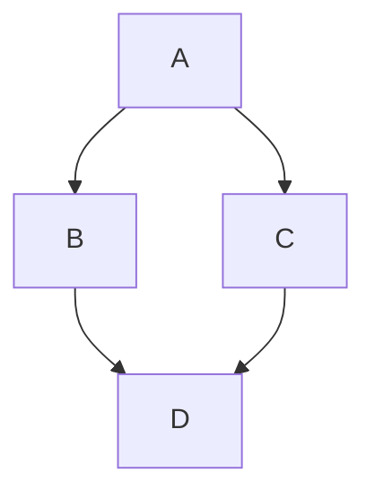
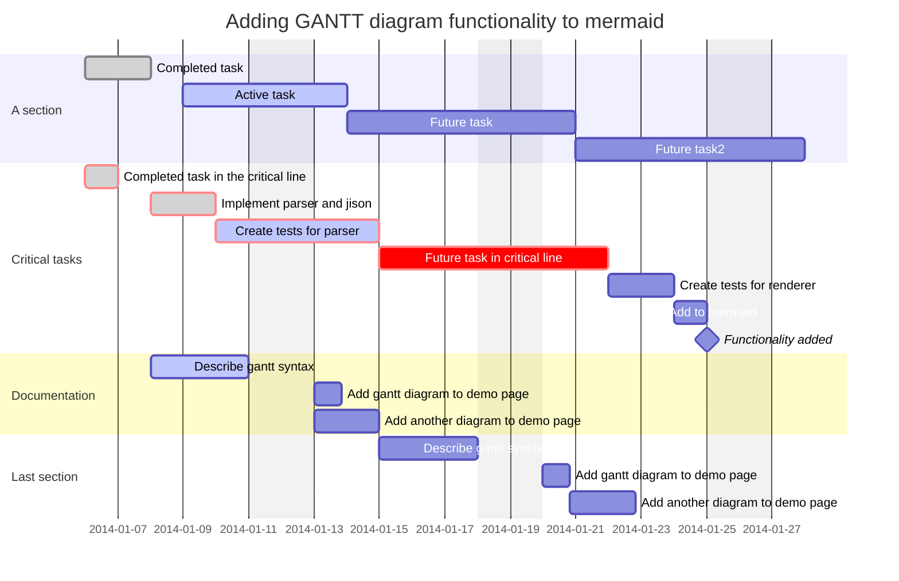

>zettekasten 卡片盒记忆法，是一种做笔记、知识管理的方法。卡片盒笔记法有许多变种，多以运用卡片索引的方式，串联各种笔记。
>[使用zettekasten原则](https://forum.obsidian.md/t/12-principles-for-using-zettelkasten/51679)

**多光标协同**
如果你按住 `alt`（mac 上是 `option`）并点击，你将可以创建多个光标。这在为多行增加或删除相同内容时十分有效。比如，你可以通过这种方式同时在几行内容前加上 `-`，从而将它们快速地变为列表。同样的方式也可以用于将几行内容变为一系列链接。
要取消多光标模式，只需要点击任意位置或者按下 esc 键即可。 ^2398

[**格式化笔记**](https://publish.obsidian.md/help-zh/%E4%BD%BF%E7%94%A8%E6%8C%87%E5%8D%97/%E6%A0%BC%E5%BC%8F%E5%8C%96%E7%AC%94%E8%AE%B0)

[Obsidian](http://obsidian.md)
这是一个^[我喜欢用行内注脚]有注脚的文字[^长注脚]。
LaTeX语法：
$$\begin{vmatrix}a & b\\ c & d \end{vmatrix}=ad-bc$$
[mermaid图表](https://mermaid.js.org/intro/)使用：



**标签**
 点击标签可以查看所有含有当前标签文章 #示例
[ **块链接与块引用**](https://publish.obsidian.md/help-zh/%E4%BD%BF%E7%94%A8%E6%8C%87%E5%8D%97/%E5%9D%97%E9%93%BE%E6%8E%A5%E4%B8%8E%E5%9D%97%E5%BC%95%E7%94%A8)
 [[生活#^6fcf12]]
 [[信息安全#^4e2d59]]
手动创建块id[[#^2398]]

## 插入iframe

参考： https://www.reddit.com/r/ObsidianMD/comments/11qpy1l/how_do_you_embed_a_reddit_post_to_obsidian_using/?utm_source=share&utm_medium=web3x&utm_name=web3xcss&utm_term=1&utm_content=share_button
插入 **Reddit Embed**


插入的源码
```html
<iframe src="https://embed.reddit.com/r/SteamDeck/comments/v22ddf/guide_how_to_use_your_deck_as_a_steam_input/?embed=true&amp;ref_source=embed&amp;ref=share&amp;utm_medium=widgets&amp;utm_source=embedv2&amp;utm_term=23&amp;theme=dark&amp;showmedia=false&amp;utm_name=post_embed&amp;embed_host_url=https%3A%2F%2Fpublish.reddit.com%2Fembed" width="640" scrolling="no" allowfullscreen="true" sandbox="allow-scripts allow-same-origin allow-popups" allow="clipboard-read; clipboard-write" style="border: none; max-width: 100%; border-radius: 8px; display: block; margin: 0px auto; --darkreader-inline-border-top: none; --darkreader-inline-border-right: none; --darkreader-inline-border-bottom: none; --darkreader-inline-border-left: none;" data-darkreader-inline-border-top="" data-darkreader-inline-border-right="" data-darkreader-inline-border-bottom="" data-darkreader-inline-border-left="" height="240"></iframe>
```

<iframe border=0 frameborder=0 height=250 width=450 src="https://twitframe.com/show?url=https%3A%2F%2Ftwitter.com%2Fjack%2Fstatus%2F20"> </iframe>
插入YAML Metadata标签模版**templater**
使用插件[templater](https://silentvoid13.github.io/Templater/internal-functions/internal-modules/file-module.html)
creation data: <% tp.file.creation_date() %>

[templater使用方法](【obsidian templater终极指南 ｜ 轻松记笔记的技巧】 https://www.bilibili.com/video/BV1qu411c7B5/?share_source=copy_web&vd_source=f23f21ade8833974b7f0f8010d2a6bab)

**Dataview**
[【5分钟快速上手dataview ｜ 高效笔记管理 ｜ dataview新手教学 ｜ 卡片盒笔记实现】 ](https://www.bilibili.com/video/BV1Xh4y1K7bu/?share_source=copy_web&vd_source=f23f21ade8833974b7f0f8010d2a6bab)


```

[^长注脚]: 你好
```

## 网页博客版本
使用工具
https://github.com/jackyzha0/quartz

## 插件

### image auto upload plugin
目前不用这个了


### [Obsidian-Code-Styler](https://github.com/mayurankv/Obsidian-Code-Styler) 


### ~~[obsidian-shiki-plugin](https://github.com/mProjectsCode/obsidian-shiki-plugin)
语法高亮！嘻嘻~~

### [obsidian-image-converter](https://github.com/xRyul/obsidian-image-converter)
使用这个，直接上传并压缩到 oneDrive
### Remotely Save
### Easy-typing
https://github.com/Yaozhuwa/easy-typing-obsidian/blob/master/README_ZH.md
### [obsidian-global-proxy](https://github.com/windingblack/obsidian-global-proxy)
obsidian://show-plugin?id=global-proxy
